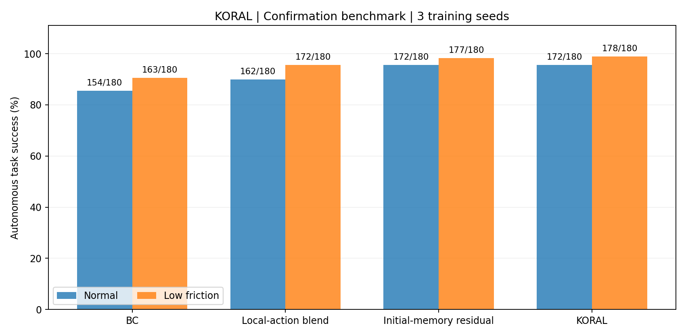

# KORAL

**Kernel-Optimized Residual Action Learning**

Support-gated local residual learning for robotic manipulation.

[中文说明](README_CN.md) · [Method](docs/METHOD.md) · [Experiments](docs/EXPERIMENTS.md) · [Installation](docs/INSTALL.md)


[Offline interactive replay](docs/demo/replay.html) · [BC recording](docs/demo/bc/demo.gif) · [KORAL recording](docs/demo/koral/demo.gif)

## Overview

KORAL improves a demonstration-trained manipulation policy with local, data-supported action corrections. A frozen neural action-chunk prior retains nominal behavior. A contact-state memory fits the errors of that prior using query-centered ridge regression. Compact support controls where the residual is applied, while purchased recovery segments extend the memory through measured learning credit and separate retention checks.

The implementation covers the complete loop: demonstration collection, policy learning, recovery acquisition, closed-loop execution, paired evaluation, trajectory auditing and interactive replay.

```text
Observation history → Frozen action prior ───────────────────┐
        └───────────→ Local residual fit → Support gate ─────┤
                                                     Bounded action
                                                           ↓
                                          Grasp → Transport → Place
```

## Results

Three independent neural training seeds; identical task definitions, control limits and starting checkpoints. Final evaluations execute the learned policies without expert actions. The recorded CPU backend is `contact_proxy`: a seven-joint kinematic arm with dynamic object contact. See the [model specification](docs/MODEL.md).

### Fixed reference scenes

| Method | Normal success | Low-friction success |
|---|---:|---:|
| Behavior cloning | 54/60 (90.00%) | 47/60 (78.33%) |
| **KORAL** | **58/60 (96.67%)** | **58/60 (96.67%)** |

### Additional frozen confirmation scenes

| Method | Normal success | Low-friction success |
|---|---:|---:|
| Behavior cloning | 154/180 (85.56%) | 163/180 (90.56%) |
| **KORAL** | **172/180 (95.56%)** | **178/180 (98.89%)** |



The [complete experiment report](docs/EXPERIMENTS.md) includes eleven reference methods, five confirmation methods, per-training-seed outcomes, paired confidence intervals, all component ablations and actual expert costs. [Raw records](results/reference/episodes.json) link every outcome to a stored trajectory and frozen checkpoint.

## Core components

| Component | Implementation |
|---|---|
| Immutable neural prior | Three history-conditioned action-chunk networks |
| Local residual model | 20-dimensional contact-state features, 24 neighbors, 21-by-21 ridge solve |
| Support gating | Exact fallback to the neural prior outside the memory's support radius |
| Recovery acquisition | Consecutive paid expert segments, measured learning-credit regression |
| Memory admission | Separate nominal/low-friction retention checks |
| Evaluation | 3,120 stored episodes, paired scene IDs, trace-based success audit |

## Quick start

```bash
python -m pip install -e '.[fast,viz,test]'
python -m pytest -q
python -m koral doctor
python -m koral demo --checkpoint results/reference/seed_2/koral/policy.pt --seed 99011 --disturbance low_friction --out runs/demo --gif
```

The example writes an executed-state GIF, trajectory NPZ and outcome JSON. The homepage illustration uses a separate development scene; completed policies hold their final recorded frame.

## Reproduce the complete study

```bash
python -m koral reproduce --config configs/local_recovery.json --out runs/study
python -m koral audit --results runs/study
python -m koral report --results runs/study --out runs/study/REPORT.md
```

For a small workflow check, use `configs/smoke.json`. To independently regenerate the packaged policy trajectories:

```bash
python -m koral verify --results results/reference --methods bc koral --banks reference confirmation
```

## Repository

```text
koral/recovery/       learning, local inference, acquisition and evaluation
configs/             full, smoke and optional joint-dynamics configurations
results/reference/   data, policy weights, frozen protocol and trajectory records
docs/                model, mathematics, experimental results and replay
scripts/             reproduction, audit and independent replay entry points
tests/               numerical, model, budget and end-to-end checks
```

[Validation record](docs/VALIDATION.md) · [Failure diagnostics](docs/FAILURES.md) · [Related work](docs/RELATED_WORK.md) · [License](LICENSE)
