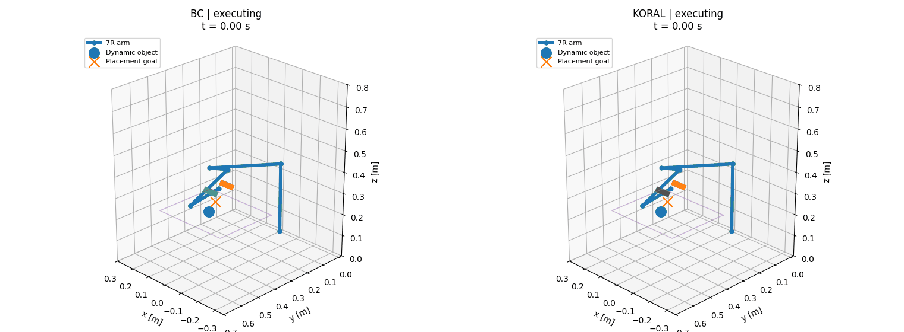
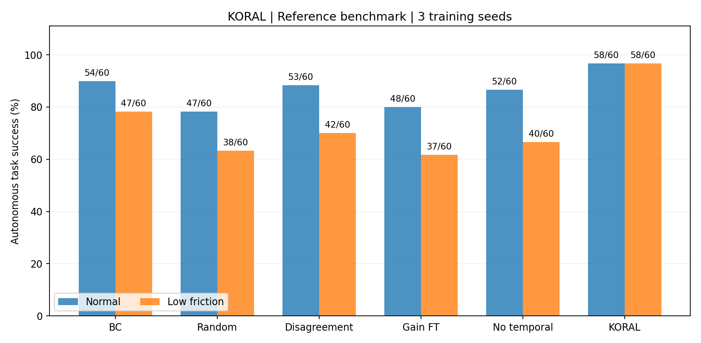

# KORAL

**Kernel-Optimized Residual Action Learning**

面向机器人操作的支持域门控局部残差学习。

[English](README.md) · [算法模型](docs/METHOD.md) · [实验报告](docs/EXPERIMENTS.md) · [安装与运行](docs/INSTALL.md)



[离线交互回放](docs/demo/replay.html) · [BC 动画](docs/demo/bc/demo.gif) · [KORAL 动画](docs/demo/koral/demo.gif)

## 方法概述

KORAL在保留行为克隆策略的基础上，学习具有局部数据支持的动作修正。神经网络参数保持固定；接触状态记忆库拟合BC在相似状态中的动作误差，通过局部仿射回归生成修正量。支持域门控调节修正强度，远离已有数据时返回原策略动作。

训练阶段按预算购买连续恢复片段，以实际开发集学习收益选择后续片段。独立的保留能力检查决定是否将新片段加入部署记忆库。最终策略只读取观测历史，不调用专家。

```text
观测历史 → 冻结 BC → 名义动作 ─────────────────┐
    └──→ 接触状态特征 → 局部残差 → 支持域门控 ─┤
                                          有界动作
                                             ↓
                                  抓取 → 搬运 → 放置
```

## 实测结果

实验使用三个独立训练种子，各方法共享初始BC权重、任务定义、控制限制和成功判据。记录后端为 `contact_proxy`，包含七关节运动学控制与动态物体接触；具体参数见[模型说明](docs/MODEL.md)。

### 固定参考场景

| 方法 | 常规成功数 | 低摩擦成功数 |
|---|---:|---:|
| 初始行为克隆 BC | 54/60 (90.00%) | 47/60 (78.33%) |
| **KORAL** | **58/60 (96.67%)** | **58/60 (96.67%)** |

### 新增冻结复核场景

| 方法 | 常规成功数 | 低摩擦成功数 |
|---|---:|---:|
| 初始行为克隆 BC | 154/180 (85.56%) | 163/180 (90.56%) |
| **KORAL** | **172/180 (95.56%)** | **178/180 (98.89%)** |



完整实验覆盖11种参考方法、5种复核方法，共保存3,120次评测记录。报告包含所有消融、逐训练种子结果、配对置信区间、专家动作数量和开发评估开销。原始数据与模型权重位于 `results/reference/`。

## 核心实现

| 模块 | 内容 |
|---|---|
| 动作先验 | 三成员行为克隆集成，4帧历史，8步动作预测 |
| 局部残差 | 20维接触特征，24个近邻，带正则化的局部仿射拟合 |
| 支持域门控 | 数据支持范围之外精确返回BC动作 |
| 恢复学习 | 连续片段采集、实际学习收益回归、专家动作预算 |
| 记忆更新 | 常规与低摩擦开发场景分别检查保留能力 |
| 评测与审计 | 冻结模型、配对场景、物理状态复核、独立轨迹重放 |

## Windows 快速运行

在项目根目录打开 PowerShell：

```powershell
py -3.11 -m venv .venv
.\.venv\Scripts\python.exe -m pip install -e ".[fast,viz,test]"
.\.venv\Scripts\python.exe -m pytest -q
.\.venv\Scripts\python.exe -m koral doctor
.\.venv\Scripts\python.exe -m koral demo --checkpoint results/reference/seed_2/koral/policy.pt --seed 99011 --disturbance low_friction --out runs/demo --gif
```

输出包括运动GIF、逐步轨迹和指标JSON。首页动画采用独立开发场景；已完成的策略停留在最后一个记录帧。离线交互HTML支持拖动时间轴和旋转视角。

## 完整复现

```powershell
.\.venv\Scripts\python.exe -m koral reproduce --config configs/local_recovery.json --out runs/study
.\.venv\Scripts\python.exe -m koral audit --results runs/study
```

该命令串联示范采集、独立种子训练、恢复学习、基线与消融、冻结评测和结果审计。小规模执行检查使用 `configs/smoke.json`。每次运行请选择一个空输出目录。

[验证记录](docs/VALIDATION.md) · [故障诊断](docs/FAILURES.md) · [相关工作](docs/RELATED_WORK.md) · [许可证](LICENSE)
